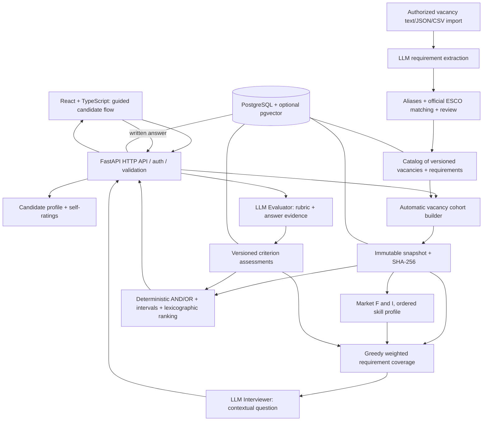
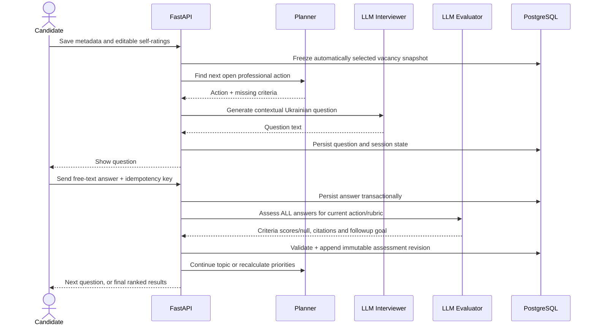

# CompetenceMatch — system architecture

## 1. Purpose and user journey

The application is **candidate-oriented**. The purpose is to assess professional actions through one adaptive interview and recommend jobs using a structured, explainable profile. It is not a recruitment decision engine and never claims a probability of being hired.

First login is a guided process, not a dashboard of tabs:

1. **Welcome** — brief Ukrainian explanation, one clear call to action.
2. **Candidate profile** — name (display only), profession/specialization, experience, work mode, location, non-negotiables and **editable self-ratings for familiar professional actions**. Do not make people rate dozens of rubric subcriteria.
3. **Adaptive interview** — the backend silently constructs a frozen candidate-appropriate vacancy cohort and ordered market-skill profile; the candidate receives a natural LLM-guided chat. There is no manual job selection. Maximum 10 different professional action topics, 5 displayed questions each, normally 1–2. Typed responses by default.
4. **Results** — immutable interview criterion assessments alongside editable self-ratings, ranked vacancies with explanations, and an ordered market-skills table. The latter has **no n/N counts, fractions or demand percentages**.

After the first completed results, enable a small set of useful tabs such as **Recommendations**, **All vacancies**, **My profile** and **Settings**. A returning user opens results, or the exact saved in-progress interview if unfinished.

## 2. Architecture overview

**Deployment shape:** modular monolith. The React frontend calls a FastAPI backend. Relational tables in PostgreSQL are accessed using SQLAlchemy, migrated with Alembic. `pgvector` accelerates semantic *normalization candidates* when meaningful embeddings are actually populated; cosine similarity is not job fit and does not author the final job rank. Docker Compose deploys database, migrations, API and UI. Python dependencies use `uv`, JavaScript dependencies use npm.

No private training, fine-tuning, LangChain swarm, agent orchestration framework, human reviewer on each answer or expensive ILP solver is required.

## 3. Domain boundaries and ownership

| Domain | Responsibility | Deterministic / LLM |
|---|---|---|
| Vacancy ingestion | Accept authorized inputs, deduplicate, extract provenance | LLM extraction + deterministic validation |
| Normalization | Match synonyms and ESCO concepts, store local action IDs | Lookup/semantic suggestions + accepted mapping |
| Candidate | Save metadata, action self-rating, owner access, revision | Deterministic |
| Cohort builder | Apply genuine hard metadata filters and freeze requirement versions | Deterministic |
| Market profile | Compute `F(c)` prevalence and `I(c)` normalized mass; order skills | Deterministic |
| Interview planner | Maximize open weighted coverage; cap 10 topics; replan | Deterministic |
| Interviewer | Generate one Ukrainian scenario/question per selected action, optional follow-up | LLM role |
| Evaluator | Holistically grade the entire current action series against versioned rubrics, propose criterion scores and follow-up goal | LLM role |
| Assessment acceptance | Validate rubric IDs, score range, excerpts, session scope; persist immutable version | Deterministic |
| Ranking | Interpret vacancy target criteria, AND/OR, intervals, mandatory group statuses, experience, ordered key | Deterministic |
| UI | Display progress and explanations; self-rating editable, interview grades read-only | React, no client-side ranking |

The model may propose interpretations, but backend owns identity, permissions, budgets, versioning, acceptance and sorting. **Do not run the Evaluator just to fill arbitrary numeric values for missing evidence.** `null` is valid and visible.

## 4. Important algorithms and data contracts

`MATH_SPEC.md` is canonical. Summary:

- Cohort: `V_p = {v in V : H(v,p)=1}`. Excluded vacancies remain browsable later; users do not choose the interview cohort. Distinguish hard constraints from soft job experience suitability. Extra experience is not a negative.
- Market list: sort by unique-vacancy prevalence `F(c)`, break ties by normalized group mass `I(c)`, then stable action ID. Aggregate parent technology names over unique vacancy IDs, not summed overlapping child counts. Display ranks/names, not counts or percentages.
- Adaptive planner: open groups, OR-aware weighted coverage `Q_t(T)`, greedy max marginal topic, reconsider after each completed action series. User self-rating can encourage **verification**, not establish verified evidence. No forced full ten-topic interview.
- LLM interview: the two logical roles are *Interviewer* and *Evaluator*. Interviewer owns wording, Evaluator owns criterion proposals, and the Python controller owns topic selection and budgets. Questions are generated from **action specifications and rubrics**, not a giant manually written bank. Small fixed open-text fallback is separate and honestly ungraded without a provider.
- Criterion grading: `s∈[0,1] or null`. Bands `[0,.25)`, `[.25,.50)`, `[.50,.75)`, `[.75,.90)`, `[.90,1]`, each with action-specific professional anchors and evidence. `M_c` and `E_c` are descriptive profile values; matching uses exact criteria.
- Vacancy target: each required criterion has documented `τ∈(0,1]` and source/policy. Unknown thresholds render a requirement not yet evaluable, not automatically achieved. OR alternatives use `max`, never sum.
- Recommendation sorting: descending `(Z, X, L_mandatory, L_preferred, -W_mandatory, -W_preferred)`, stable string ID ascending. Mandatory unmet requirements cannot be compensated by strong optional ones. This is not a probability. `LOW_INFORMATION` when evidence is sparse.

## 5. Suggested persisted entities

- `CandidateProfile`, `CandidateSelfRating` (editable, action-level), `ProfileVersion` (immutable).
- `Vacancy` and `VacancyRevision`, `RequirementGroup`, `RequirementAlternative`, `RequirementTargetCriterion`, `VacancySnapshot` (frozen copy/digest).
- `CompetencyConcept` (ESCO URI nullable, normalized labels/aliases), `CompetencyAction` (specific assessable professional activity), `Rubric`, `RubricCriterion` (stable IDs, descriptions, anchors, weights, version).
- `MarketProfile` (snapshot, policy, order and internal weights).
- `InterviewSession` (owner, state, version, snapshot, budgets), `InterviewTurn` (action, question, answer, index, idempotency key), `CriterionAssessment` (score/null, reason, evidence turn/excerpt, provider, rubric revision, assessment revision), `AssessmentReviewRequest` (optional disputes).
- `RankingRun`, `RankingItem` (snapshot/profile/policy, key components, explanations).
- `IngestionJob` and `NormalizationCandidate` for scalable source processing and reviewable ambiguous matches.

Minimum migration requirement: preserve the 90 synthetic fixture vacancies and existing users, maintain UUID/int ID stability and owner-scoped API semantics. **Do not quietly cast 0–3 source data into a different scale**; use a documented conversion/provenance policy. Existing `competency_vectors` HNSW infrastructure is not proof that embeddings are generated; implement a genuine population pipeline before using semantic lookup.

## 6. Session sequence and error recovery

A recoverable provider timeout must not fabricate an assessment, duplicate a shown question or silently skip a topic. Show retry/resume. Missing provider: use honest limited question capture without numeric interview certification. User cancellation retains previous accepted evidence. Scope every query and update to authenticated owner; keep secrets out of logs.

## 7. Frontend behavior and source transparency
We use TailWind and shadcn/UI

All user-visible Ukrainian must be written as real Ukrainian strings, not custom romanization/transliteration (`u(...)`). Preserve correct English tool names (FastAPI, PostgreSQL) as product names. Screens must work at mobile widths and keyboard-only navigation, have labeled forms, error/empty/busy/loading states and reduced-motion CSS. Animations are subtle state transitions, not artificial wait times.

The seeded 90 vacancy records are **invented structured data**; production claims about current vacancies require authorized real sources and freshness checks. Remove advertising labels such as “demo app” from the main experience, but keep transparent data provenance in an accessible catalog information panel. Do not invent live job links or employer outreach. The market-skill table is explicitly scoped to the selected catalog segment.

## 8. Implementation order and verification

1. Inventory existing code and run baseline pytest before modifications.
2. Migrations and deterministic pure-domain math with exhaustive edge/property tests.
3. Candidate metadata/profile and automatic cohort + market profile endpoints.
4. Two LLM role prompts, rubric generation/curation and topic-series evaluation, state-version/idempotency.
5. Vacancy criterion targets, explainable ranking, `LOW_INFORMATION` and persistence.
6. Four-stage Ukrainian UX and full frontend audit.
7. Authorized manual/CSV/JSON ingestion, LLM extraction, ESCO candidate matching/normalization, cache/review.
8. Actual tests: Python, TypeScript, PostgreSQL, browser flow and provider mocks (plus real provider if configured). Report results precisely; don't assert tests ran just because a spec lists them.

**Current-code inventory reminder:** existing API modules are `app/backend/api/{auth,profile,catalog,interviews,matches,llm}.py`; domain files `app/backend/domain/{adaptive,matching}.py`; ORM `app/backend/models.py`; React UI `app/frontend/src/App.tsx`. The existing React page currently exposes manual selection, multiple-choice items, old numeric matching and a Ukrainian transliteration helper, which must all be removed from the intended candidate flow. Current backend tests exercise older logic and do not verify these new modules until rewritten.
