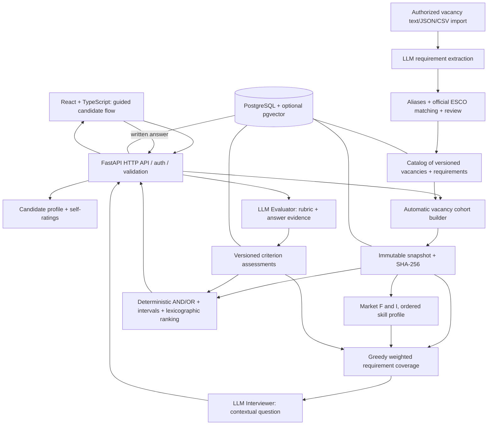
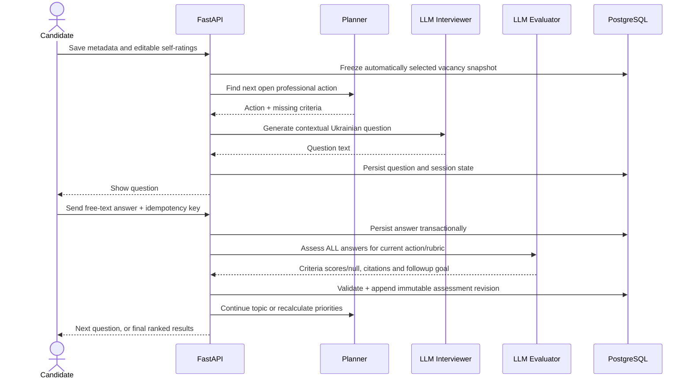

# CompetenceMatch — system architecture

## 1. Purpose and user journey

The application is **candidate-oriented**. The purpose is to assess professional actions through one adaptive interview and recommend jobs using a structured, explainable profile. It is not a recruitment decision engine and never claims a probability of being hired.

First login is a guided process, not a dashboard of tabs:

1. **Welcome** — brief Ukrainian explanation, one clear call to action.
2. **Candidate profile** — name (display only), profession/specialization, experience, work mode, location, non-negotiables and **editable self-ratings for familiar professional actions**. Do not make people rate dozens of rubric subcriteria.
3. **Adaptive interview** — the backend silently constructs a frozen candidate-appropriate vacancy cohort and ordered market-skill profile; the candidate receives a natural LLM-guided chat. There is no manual job selection. Maximum 10 different professional action topics, 5 displayed questions each, normally 1–2. Typed responses by default.
4. **Results** — immutable interview criterion assessments alongside editable self-ratings, ranked vacancies with explanations, and an ordered market-skills table. The latter has **no n/N counts, fractions or demand percentages** in the results view. Market distribution by track (share of vacancies per competency) is a separate market page; whether it shows percentages is an open owner decision (`docs/tasks/TODO.md`, §0б and §5).

After the first completed results, enable a small set of useful tabs such as **Recommendations**, **All vacancies**, **My profile** and **Settings**. A returning user opens results, or the exact saved in-progress interview if unfinished.

## 2. Architecture overview

**Deployment shape:** modular monolith. The React frontend calls a FastAPI backend. Relational tables in PostgreSQL are accessed using SQLAlchemy, migrated with Alembic. `pgvector` accelerates semantic *normalization candidates* when meaningful embeddings are actually populated; cosine similarity is not job fit and does not author the final job rank. Docker Compose deploys database, migrations, API and UI. Python dependencies use `uv`, JavaScript dependencies use npm.

No private training, fine-tuning, LangChain swarm, agent orchestration framework, human reviewer on each answer or expensive ILP solver is required.

## 3. Domain boundaries and ownership

| Domain | Responsibility | Deterministic / LLM |
|---|---|---|
| Vacancy ingestion | Accept authorized inputs, deduplicate, extract provenance | LLM extraction + deterministic validation |
| Normalization | Match synonyms and ESCO concepts, store local action IDs | Lookup/semantic suggestions + accepted mapping |
| Candidate | Save metadata, action self-rating, owner access, revision | Deterministic |
| Cohort builder | Apply genuine hard metadata filters and freeze requirement versions | Deterministic |
| Market profile | Compute `F(c)` prevalence and `I(c)` normalized mass; order skills | Deterministic |
| Interview planner | Maximize open weighted coverage; cap 10 topics; replan | Deterministic |
| Interviewer | Generate one Ukrainian scenario/question per selected action, optional follow-up | LLM role |
| Evaluator | Holistically grade the entire current action series against versioned rubrics, propose criterion scores and follow-up goal | LLM role |
| Assessment acceptance | Validate rubric IDs, score range, excerpts, session scope; persist immutable version | Deterministic |
| Ranking | Interpret vacancy target criteria, AND/OR, intervals, mandatory group statuses, experience, ordered key | Deterministic |
| UI | Display progress and explanations; self-rating editable, interview grades read-only | React, no client-side ranking |

The model may propose interpretations, but backend owns identity, permissions, budgets, versioning, acceptance and sorting. **Do not run the Evaluator just to fill arbitrary numeric values for missing evidence.** `null` is valid and visible.

## 4. Important algorithms and data contracts

`MATH_SPEC.md` is canonical. Summary:

- Cohort: `V_p = {v in V : H(v,p)=1}`. Excluded vacancies remain browsable later; users do not choose the interview cohort. Distinguish hard constraints from soft job experience suitability. Extra experience is not a negative.
- Market list: sort by unique-vacancy prevalence `F(c)`, break ties by normalized group mass `I(c)`, then stable action ID. Aggregate parent technology names over unique vacancy IDs, not summed overlapping child counts. Results view shows ranks/names, not counts or percentages. Market page percentages: open owner decision (`docs/tasks/TODO.md` §5).
- Adaptive planner: open groups, OR-aware weighted coverage `Q_t(T)`, greedy max marginal topic, reconsider after each completed action series. User self-rating can encourage **verification**, not establish verified evidence. No forced full ten-topic interview.
- LLM interview: the two logical roles are *Interviewer* and *Evaluator*. Interviewer owns wording, Evaluator owns criterion proposals, and the Python controller owns topic selection and budgets. Questions are generated from **action specifications and rubrics**, not a giant manually written bank. Small fixed open-text fallback is separate and honestly ungraded without a provider.
- Criterion grading: `s∈[0,1] or null`. Bands `[0,.25)`, `[.25,.50)`, `[.50,.75)`, `[.75,.90)`, `[.90,1]`, each with action-specific professional anchors and evidence. `M_c` and `E_c` are descriptive profile values; matching uses exact criteria.
- Vacancy target: each required criterion has documented `τ∈(0,1]` and source/policy. Unknown thresholds render a requirement not yet evaluable, not automatically achieved. OR alternatives use `max`, never sum.
- Recommendation sorting: descending `(Z, X, L_mandatory, L_preferred, -W_mandatory, -W_preferred)`, then self-rating tie-breaks `T_v`, `J_v` (descending), then stable string ID ascending. The profile results screen uses a display ordering instead: `confirmed_share` (mean lower bound, percent) first, ties broken by that key (owner decision; `MATH_SPEC.md` §3d, §5). Mandatory unmet requirements cannot be compensated by strong optional ones. This is not a probability. `LOW_INFORMATION` when evidence is sparse.

### Follow-up flow within a topic

1. Candidate answer is persisted (idempotency key). 2. Evaluator grades all topic answers and may return a `followup_goal` (criterion ids, reason, expected evidence). 3. Backend sanitizes the goal to rubric-valid, still-open criteria (`UNKNOWN`/`WEAK`; `CONFIRMED`/`DECLINED` are closed) and persists it as `eval_goal` (+ `followup_reason`) on the answered `core_turns` row (migration 0009). 4. The next question is generated for the goal criteria, or all open criteria without a goal; the goal text is passed to the Interviewer as delimited untrusted context. Bank-fallback turns carry no goal (`followup_reason=BANK_FALLBACK`). 5. No open criteria: the topic closes early. While criteria are open, the minimum of two questions applies; after that the topic is re-asked only when its latest score is null or its last answered turn left a sanitized goal on a still-open criterion. Caps: 5 shown questions per topic, 10 topics. A null criterion forces `sufficient_evidence=false` in Python. The API returns `M_c` with coverage `E_c` and `overall_level_allowed` (`E_c>=0.6`); the UI does not use them yet. In the vacancy breakdown an alternative is `BORDERLINE` only when every required criterion is graded, otherwise `UNKNOWN` with its `coverage` (`MATH_SPEC.md` §3a, §5).

### Difficulty flow within a topic

Difficulty is chosen by the deterministic `DifficultyController` (`domain/difficulty.py`, `MATH_SPEC.md` §3c), not by the LLM. On each `next_question` the backend replays controller state from the topic's stored `core_turns` (`difficulty` of the shown turns, shown count) and runs `next_step` on the latest criterion scores, sufficiency, open criteria and goal. A topic without turns starts at `initial_difficulty` (candidate level, else market `years_min` median). The decision either closes the topic (no open criteria, cap, or enough evidence) or yields the level for the next question, which is passed to the Interviewer as `difficulty`. The Evaluator receives per-turn `difficulty` and target criteria as context only; difficulty never changes or caps scores or `τ`. Persisted per question: `difficulty`, `difficulty_reason`, `controller_before`, `controller_after` (migration 0010). These fields are internal: not returned to the candidate UI, no difficulty label shown.

### Experiment engine flow (Phase 3)

`scripts/run_experiment.py` creates a separate SQLite DB (schema + seed; the product DB is refused), then for each candidate and mode calls `experiments.runner.run_experiment`, which drives the normal HTTP API through `TestClient`: register, profile, `cohorts/auto`, then (modes B/C) `POST /interviews` and a loop of `next-question` / `answers`. Answers come from an `AnswerProvider` (only `ScriptedProvider`; each record carries `answer_source`). Right after creation the runner writes `mode_config` (and, for static topics, `static_plan`) on the `core_interviews` row; the engine in `api/core.py` reads them via `_mode_config` (no row config = product defaults, unchanged behaviour). Flags: `adaptive_topics=false` takes the next topic from `static_plan` instead of `choose_next`; `adaptive_followup=false` uses fixed slots (`slot_targets`) and no goal/early close; `adaptive_difficulty=false` keeps the initial level; `total_budget` ends the interview. Mode A skips the interview and ranks with all scores unknown. The runner then ranks with `rank_items`, collects timings/errors and `store.save_record` writes one `experiment_runs` row; `export_records` writes `runs.json` and `runs.csv`. `rerank` recomputes the ranking from a stored record without an LLM. See `MATH_SPEC.md` §6a.

### Evaluation flow (Phase 4)

`scripts/evaluate_experiments.py` reads `runs.json` (from `export_records`) and optional relevance and criterion label files; it opens no database, model or network. `experiments/expert_labels.py` validates labels (schemas, annotator ids, data status, double annotation, adjudication), `experiments/metrics.py` holds pure metric functions, `experiments/report.py` groups records by mode key, applies the inclusion and exclusion rules and writes `report.json`, `report.csv` and `charts.json`. Records carry `relevant_criteria` and `qa[i]["sufficient_criteria_after"]` (migration 0012 also adds `answer_source`) so coverage is computed offline. Expert labels are evaluation ground truth only: `domain`, `api` and `experiments.{planning,runner}` never import these modules (AST test). Definitions and protocol: `MATH_SPEC.md` §6b.

### Assessed level flow (SeniorityEstimator)

Three values stay separate: desired level (profile `target_level`), assessed level and vacancy fit. In the same Evaluator call as the topic answer, python-track interviews also grade six professional-practice criteria (`practice-backend.*`, stored as `criterion_assessments` of that pseudo-action, never a vacancy competency, never a planner, D_vga or ranking input). During the interview `domain/level_probe.py` only reorders the current topic's unmet criteria and passes up to two unassessed practice criteria to the Interviewer; Q_t, caps and difficulty are unchanged. On every transition to FINISHED `api/level.finalize_level` builds evidence from that attempt only (`core.seniority_evidence`) and runs the pure `domain/seniority.estimate` with the policy version captured when the attempt started (`core_interviews.start_policy_version`, migration 0017; older attempts: the track's current policy) (`domain/seniority_policy.py`; python: `python-backend/v4`, capability-level gaps with a DECLINED state for an unknown tool whose alternative was not asked, counts over confirmed technical and practice pools, median practice aggregation, WORKING_ASSUMPTION; `v1`–`v3` stay addressable by version for stored rows; marketing/design: none → `UNKNOWN`/`POLICY_UNAVAILABLE`). The result is stored once per (attempt, policy version) in `seniority_assessments` (migration 0016) and never updated; a failure never blocks finishing, and a finished attempt without a row is assessed lazily on first read (current policy). Reads return the row of the attempt's policy, else the latest stored row, so v1–v3 rows of older attempts render unchanged. Owner-only API: `GET /interviews/{id}/level`, `GET /profiles/{id}/level`, plus a `level` block and per-item `section` labels in `/profiles/{id}/results` (order unchanged). Rules: `MATH_SPEC.md` §3e; limits: `docs/tasks/SENIORITY_REPORT.md`.

## 5. Suggested persisted entities

- `CandidateProfile`, `CandidateSelfRating` (editable, action-level), `ProfileVersion` (immutable).
- `Vacancy` and `VacancyRevision`, `RequirementGroup`, `RequirementAlternative`, `RequirementTargetCriterion`, `VacancySnapshot` (frozen copy/digest).
- `CompetencyConcept` (ESCO URI nullable, normalized labels/aliases), `CompetencyAction` (specific assessable professional activity), `Rubric`, `RubricCriterion` (stable IDs, descriptions, anchors, weights, version).
- `MarketProfile` (snapshot, policy, order and internal weights).
- `InterviewSession` (owner, state, version, snapshot, budgets), `InterviewTurn` (action, question, answer, index, idempotency key), `CriterionAssessment` (score/null, reason, evidence turn/excerpt, provider, rubric revision, assessment revision), `AssessmentReviewRequest` (optional disputes).
- `SeniorityAssessment` (immutable per attempt and policy version: assessed level, status, full result, rubric versions, desired level copy).
- `RankingRun`, `RankingItem` (snapshot/profile/policy, key components, explanations).
- `IngestionJob` and `NormalizationCandidate` for scalable source processing and reviewable ambiguous matches.

Minimum migration requirement: preserve the 90 synthetic fixture vacancies and existing users, maintain UUID/int ID stability and owner-scoped API semantics. **Do not quietly cast 0–3 source data into a different scale**; use a documented conversion/provenance policy. Existing `competency_vectors` HNSW infrastructure is not proof that embeddings are generated; implement a genuine population pipeline before using semantic lookup.

## 6. Session sequence and error recovery

A recoverable provider timeout must not fabricate an assessment, duplicate a shown question or silently skip a topic. Show retry/resume. Missing provider: use honest limited question capture without numeric interview certification. User cancellation retains previous accepted evidence. Scope every query and update to authenticated owner; keep secrets out of logs.

## 7. Frontend behavior and source transparency
We use TailWind and shadcn/UI

All user-visible Ukrainian must be written as real Ukrainian strings, not custom romanization/transliteration (`u(...)`). Preserve correct English tool names (FastAPI, PostgreSQL) as product names. Screens must work at mobile widths and keyboard-only navigation, have labeled forms, error/empty/busy/loading states and reduced-motion CSS. Animations are subtle state transitions, not artificial wait times.

The seeded vacancy records (`app/fixtures/vacancies.json`, 180 entries) are **invented structured data**; production claims about current vacancies require authorized real sources and freshness checks. Remove advertising labels such as “demo app” from the main experience, but keep transparent data provenance in an accessible catalog information panel. Source of the original records (`DEMO_CURATED` in repo vs. owner's statement "Djinni") is an open owner decision (`docs/tasks/TODO.md` §4, §5); do not describe them as Djinni postings until confirmed. Do not invent live job links or employer outreach. The market-skill table is explicitly scoped to the selected catalog segment.

## 8. Implementation order and verification

1. Inventory existing code and run baseline pytest before modifications.
2. Migrations and deterministic pure-domain math with exhaustive edge/property tests.
3. Candidate metadata/profile and automatic cohort + market profile endpoints.
4. Two LLM role prompts, rubric generation/curation and topic-series evaluation, state-version/idempotency.
5. Vacancy criterion targets, explainable ranking, `LOW_INFORMATION` and persistence.
6. Four-stage Ukrainian UX and full frontend audit.
7. Authorized manual/CSV/JSON ingestion, LLM extraction, ESCO candidate matching/normalization, cache/review.
8. Actual tests: Python, TypeScript, PostgreSQL, browser flow and provider mocks (plus real provider if configured). Report results precisely; don't assert tests ran just because a spec lists them.

**Current-code inventory:** API modules `app/backend/api/{auth,profile,catalog,interviews,matches,llm}.py`; domain files `app/backend/domain/{adaptive,matching}.py`; ORM `app/backend/models.py`; React UI `app/frontend/src/` (screens in `screens/`, routes in `routes.tsx`, shell in `components/AppShell.tsx`). Transliteration helper `u(...)` is no longer found in frontend source. Progress and open items: `docs/tasks/STATUS.md` and `docs/tasks/TODO.md`.
